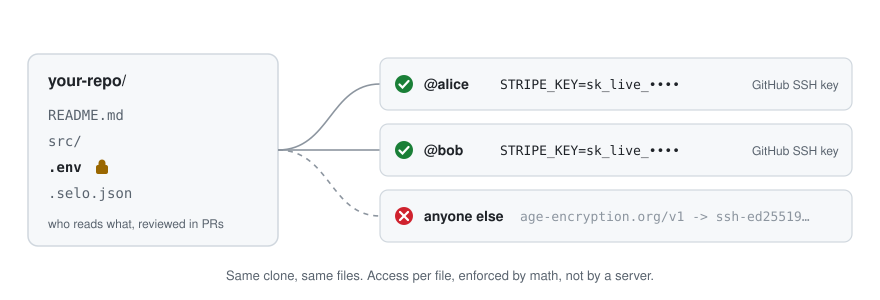
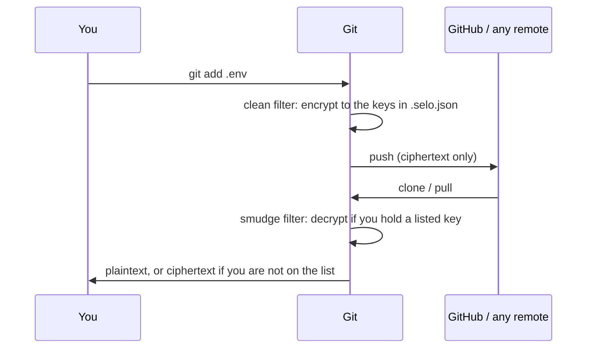

<!-- resumo: Arquivo privado dentro de um repositório Git comum: o .env vai cifrado (formato age) para as chaves SSH que o time já tem no GitHub, quem pode ler é código revisado em PR, e o check de CI reprova segredo em texto claro. -->

<div align="center">

# git selo

**Private files inside a normal Git repo.**
Your `.env` is committed encrypted to the SSH keys your teammates already have on GitHub.

[](https://github.com/thiagopatzdorf/git-selo/actions/workflows/test.yml)
[](https://www.npmjs.com/package/git-selo)
[](LICENSE)


[](https://age-encryption.org)



</div>

> "Source control being 100% or 0% access feels stupider than ever. I want private files in my repos.
> I want secret management that doesn't require some obscure 3rd party tools." — [Theo](https://x.com/theo), 2026

Git hands every object to whoever clones, so access is all-or-nothing **per repo**. `git selo` moves
the boundary to the **file**: everything else stays as it is, but a protected file only opens for the
keys listed for it. No server, no account, no new key to hand out.

## 60 seconds

```sh
npm i -g git-selo                         # zero dependencies, Node ≥ 20 (or: npx git-selo …)
git selo init                             # protects .env* by default, sets up the Git filters
git selo add @alice @bob                  # fetches github.com/alice.keys and pins them in .selo.json
git add -A && git commit -m "the junior pushed the .env, and it's fine"
```

A teammate on the list clones and runs `git selo unlock` once. From then on `git pull`, `git diff` and
editing just work, and diffs show plaintext. Someone not on the list gets ciphertext on disk, and nothing
breaks for them either.

## What it looks like

Real output, against the 21 SSH keys [@t3dotgg](https://github.com/t3dotgg.keys) publishes on GitHub:

```console
$ git selo add @me @t3dotgg
@me: pinned 1 key(s)
@t3dotgg: pinned 21 key(s)
$ printf "STRIPE_KEY=sk_live_123\n" > .env
$ git add -A && git commit -qm "the junior pushed the .env"

$ git show HEAD:.env | head -3          # what GitHub, forks and old clones store
age-encryption.org/v1
-> ssh-ed25519 hS6BXA XZU01pi5PLW63ektrcLNFJwljWjSl3HRll3eDOne2Ag
sotoQOmkrJB0kQz1CbDS2gvP2KUZi3mzy5YI6HqZBKk

$ cat .env                              # what a reader has on disk
STRIPE_KEY=sk_live_123

$ git selo status
.env
  readers: @me, @t3dotgg
  you can read
```

## Private branches

Theo also asked for *"private branches that only 3 team members can see"*. Same idea, applied to commits:

```sh
git checkout -b launch && git commit -am "the secret thing"
git selo branch push launch --for core   # the whole branch, encrypted to the "core" group
git selo branch list                     # what exists, and which ones you can open
git selo branch pull launch              # readers get it back as a normal Git branch
```

- The branch becomes a [git bundle](https://git-scm.com/docs/git-bundle) of only the commits the remote doesn't
  have yet, encrypted with age to the group's keys, stored in the **same repo** under `refs/selo/<name>`.
  A normal `git clone` doesn't even download it; for anyone not on the list it is an unreadable blob.
- Readers get a real branch back: history, messages, files, `git log`, everything. They commit and
  `git selo branch push` again, and the rest of the team pulls.
- **The habit guard:** `git selo` installs a `pre-push` hook that refuses `git push origin launch`
  for any branch `.selo.json` marks private, so muscle memory can't leak it in plaintext.
- Who can read a branch lives in `"branches"` in `.selo.json`, taken from the remote's main branch, so
  a stale copy inside an old branch can't loosen it.

What it doesn't do: no PR/diff UI on GitHub while it's encrypted (GitHub can't read it; review
locally), and merging into `main` makes it public, which is the point of merging. The branch *name*,
size and push times are visible.

## Why it's different

- **Your identity already exists.** `@alice` means the SSH keys GitHub publishes at
  `github.com/alice.keys`. Nobody generates, emails or rotates a new key to join.
- **Access is code.** `.selo.json` says who reads what. Adding someone is a diff in a pull request,
  with the exact keys pinned, so a key changed on GitHub can't silently change who reads.
- **The CI checks the math, not a promise.** `git selo check` reads each committed blob and fails if a
  protected file is in plaintext or encrypted for anyone other than `.selo.json` says.
- **No lock-in.** Files are standard [age](https://age-encryption.org) v1. If this tool disappeared
  tomorrow: `git show HEAD:.env | age -d -i ~/.ssh/id_ed25519`.
- **Nothing to install but itself.** One Node script and `node:crypto`. No GPG, no KMS, no daemon.

## Who reads what

```json
{
  "groups": { "team": ["@alice", "@bob"], "billing": ["@alice"], "ci": ["age1q…"] },
  "files": {
    ".env*": ["team", "ci"],
    "contracts/**": ["billing"]
  },
  "keys": { "@alice": ["ssh-ed25519 AAAA…"], "@bob": ["ssh-rsa AAAA…"] }
}
```

- `files` uses `.gitattributes` patterns, and the last match wins. `git selo` keeps a managed block in
  `.gitattributes` in sync for you.
- `age1…` keys are for CI and for anyone without an ed25519 or RSA key (`git selo key` makes one).

| command | does |
|---|---|
| `git selo init` | create `.selo.json` (protecting `.env*`) and set up the Git filters in this clone |
| `git selo add @user … [--to group]` | pin their GitHub keys, add them to the group, re-encrypt |
| `git selo remove @user [--from group]` | remove them and re-encrypt (see [Limits](#limits-said-plainly)) |
| `git selo protect <pattern> [--for group]` | encrypt more files |
| `git selo status` | every protected file, its readers, and whether *you* can read it |
| `git selo check [--strict]` | the CI gate |
| `git selo unlock` / `lock` | decrypt this clone / put the ciphertext back and remove the filters |
| `git selo cat <file> [--rev REV]` | print a protected file from any commit |
| `git selo branch push <b> [--for group]` | push a whole branch encrypted to `refs/selo/<b>` |
| `git selo branch pull <b>` / `list` | get a private branch back as a normal branch / see which exist |
| `git selo key` | create `~/.config/selo/identity.txt` and print its `age1…` key |

## The CI gate

The one way left to leak is a teammate **without** git selo adding a new `.env.local` in plaintext.
The check catches that before merge:

```yaml
# .github/workflows/secrets.yml
on: [pull_request, push]
jobs:
  selo:
    runs-on: ubuntu-latest
    steps:
      - uses: actions/checkout@v4
      - uses: thiagopatzdorf/git-selo@v0      # or: run: npx git-selo check --strict
```

```console
$ git selo check --strict
git-selo: FAIL: .env.local is committed in PLAINTEXT
git-selo: FAIL: server.pem looks like a secret but is not protected (git selo protect server.pem)
```

For CI jobs that need the secrets: run `git selo key` anywhere, `git selo add age1… --to ci`, and put
the secret line in a CI secret named `SELO_IDENTITY`.

## How it works



It is a Git clean/smudge filter (`.gitattributes` → `filter=selo`). age encryption is randomized, so
the last ciphertext is cached in `.git/selo/` per file and reused while the plaintext and the reader
list are unchanged. Without that, `git status` would show every protected file as modified forever.

Keys are read from `$SELO_IDENTITY`, `$SELO_IDENTITY_FILE`, `~/.config/selo/identity.txt`,
`~/.ssh/id_ed25519` and `~/.ssh/id_rsa`.

## Tested like we mean it

- **Parity with the official `age` binary, both ways**: X25519, ssh-ed25519 and ssh-rsa; empty files,
  1 byte, exactly 64 KiB, 64 KiB + 1 and 200 KB. Tampered files are refused, not "decrypted" to garbage.
- **A whole team, end to end, with real Git**: three people and a remote. Readers, non-readers,
  diffs, revocation, and the CI gate catching a plaintext `.env.local`.
- **Real accounts**: the 21 keys @t3dotgg publishes (RSA-4096 and ed25519) become 21 recipients that
  the official `age` parses. @FiloSottile, the author of age, publishes only an ECDSA key, which age
  doesn't support; `git selo add` stops and points to `git selo key` instead of failing silently.
- **Private branches with a whole team**: no commit, message or file of the branch appears anywhere in the
  remote's objects; a plain clone doesn't fetch it; readers get the full history back; the `pre-push`
  guard stops `git push origin <private>` even from inside a branch whose `.selo.json` predates the policy;
  the encrypted bundle opens with the official `age` and `git bundle list-heads` reads it.
- CI on Node 20 and 22, and this repo protects itself with its own `.selo.json`.

## Limits, said plainly

- **Removing someone doesn't un-share the past.** They keep what they already pulled, and old commits
  stay encrypted to their key. `remove` re-encrypts going forward, so **rotate the actual secrets**
  (new API key, new password).
- **Passphrase-protected SSH keys** can't be used: the Git filter has no terminal to ask. Use
  `git selo key` for a dedicated key; the tool tells you when it skips one.
- File *names*, sizes and commit times stay visible. Only contents are protected.
- One process per protected file on add and checkout: fine for dozens of secret files, not thousands.

## Prior art

[git-crypt](https://github.com/AGWA/git-crypt), [transcrypt](https://github.com/elasticdog/transcrypt),
[SOPS](https://github.com/getsops/sops) and [git-agecrypt](https://github.com/vlaci/git-agecrypt) all
solve parts of this, and are worth a look. git selo's bet is the combination: GitHub usernames as the
identity, a reviewable reader list with pinned keys, a CI gate that checks recipients against that
list, standard age output, and zero dependencies.

## Part of MAPI

git selo is the first enforcement of `access` in [MAPI](https://github.com/thiagopatzdorf/MAPI), a
contract format where every capability says what it does, how to undo it, how to prove it worked,
what it costs, and **who may call it**.

## License

MIT, see [LICENSE](LICENSE). Made by [Genesis Innovation](https://genesisinnovation.io).

---

<sub>**Em português:** `git selo` põe arquivo privado dentro de um repositório Git comum. O `.env` vai
cifrado para as chaves SSH que cada pessoa do time já tem no GitHub: quem está na lista lê, o resto vê
só o cifrado. Quem pode ler é código (`.selo.json`), revisado em PR. O formato é o age, aberto, e abre
com a ferramenta oficial mesmo sem o git selo.</sub>
